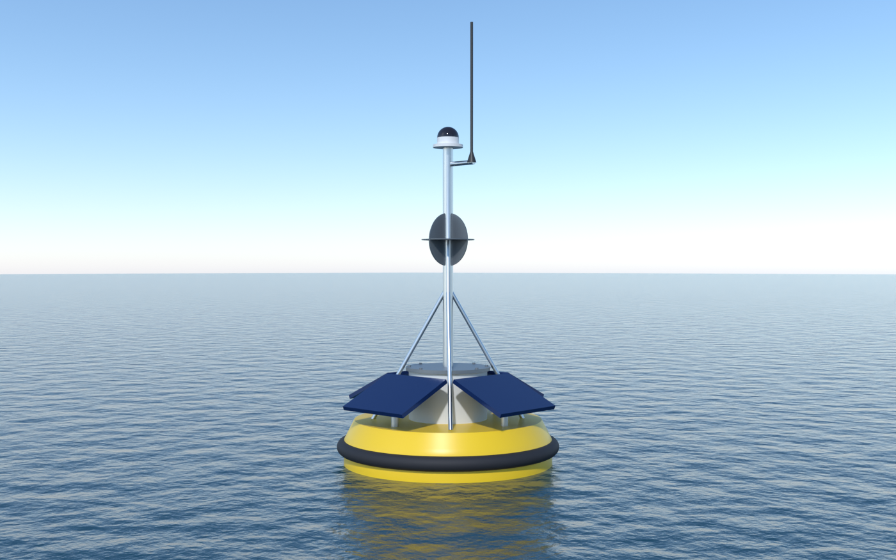
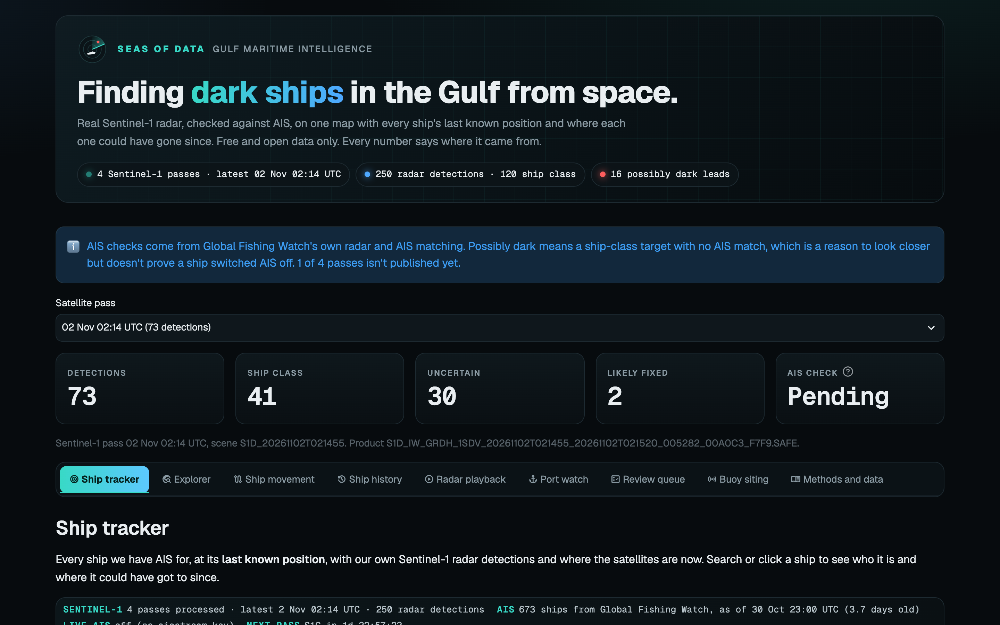
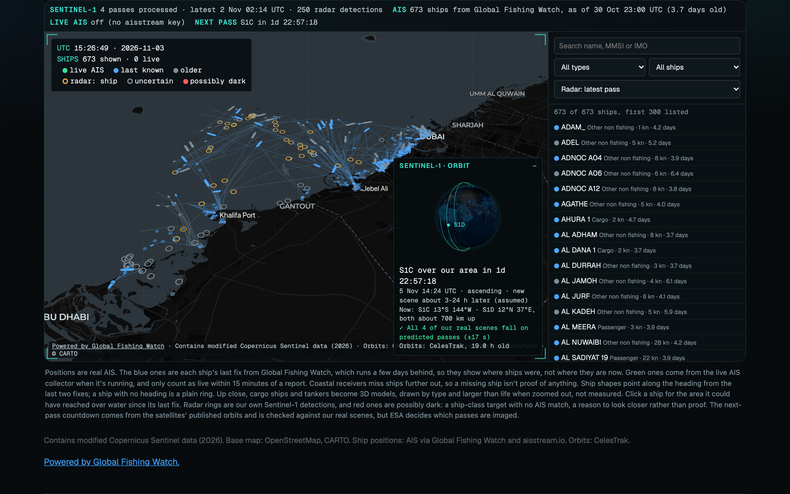
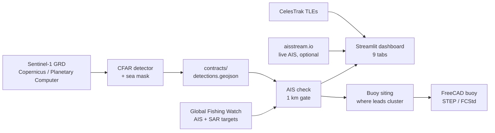

<div align="center">



# Seas of Data

### Finding dark ships in the Gulf from space.

Real Sentinel-1 radar → our own ship detector → checked against AIS → one live map, plus a buoy designed to go and look.

[](https://seas-of-data.streamlit.app)
[](https://tohraan.github.io/seas-of-data/)
[](deck/seas-of-data-deck-draft.pdf)
[](https://drive.google.com/drive/folders/1VeLYadn-BRKoaOlml7v8tPRinwTfQoEm)

**Supernova × SpacePoint Hackathon 2026 · Track: Seas of Data (maritime and ports)**

</div>

---

## The problem in one line

Ships that switch off their AIS transponder disappear from every tracking map. Radar satellites still see them, through cloud and at night.
We built the pipeline that finds them: **radar says a ship is there, AIS says nobody is**. That gap is a lead worth a closer look.

## What we built

| | |
|---|---|
| 🛰️ **Ship detector on real radar** | Four real Copernicus Sentinel-1 passes over Abu Dhabi to Dubai (24 Oct to 2 Nov 2026). A CFAR detector on a sea mask, with a radar chip for every detection so you can check it by eye. |
| 📡 **Independent AIS check** | Every detection is paired with Global Fishing Watch's AIS-matched radar targets within 1 km. Ship-class targets with no AIS become *possibly dark* leads. |
| 🗺️ **Live tracker dashboard** | A dark tactical map of 673 real ships at their last AIS position, our radar detections, the water a quiet ship could have reached since, and the live orbit of Sentinel-1C/1D with a next-pass countdown. Nine tabs in all. |
| 🛟 **Monitoring buoy, in CAD** | A solar buoy with AIS, a camera and a radio, sited where radar leads cluster. Full STEP / FreeCAD / STL, mass budget, stability and power sums. |
| 🎬 **Story site and film** | *Dark at Dawn*, a 91 s narrated explainer rendered in Blender and HyperFrames, on a scroll-driven site. |

## Results, measured not claimed

<table>
<tr>
<td width="50%"></td>
<td width="50%"></td>
</tr>
</table>

| Metric | Value | How we know |
|---|---:|---|
| Radar detections | **250** over 4 passes | Real Sentinel-1 IW GRD scenes, with sha256 and Copernicus ids in [`contracts/manifest.json`](contracts/manifest.json) |
| `ship` class precision | **94%** (95% CI 88–99%) | Seeded random sample of 120 chips, reviewed by eye; held-out half 95% ([`ml/VERIFICATION.md`](ml/VERIFICATION.md)) |
| AIS check | **48** matched · **18** with no AIS | Global Fishing Watch, 1 km gate, 3 of 4 passes (the 2 Nov pass isn't published yet) |
| Possibly dark leads | **16** ship-class targets | Radar sees a ship, AIS has nobody there. A lead, not a verdict |
| Recall vs Global Fishing Watch | **73%** of their targets in our 40 km area (79% on our sea mask) | `ml/eval_gfw.py` in [PR #11](https://github.com/tohraan/seas-of-data/pull/11). GFW is another detector, not ground truth |
| Orbit check | **4 of 4** real scenes fall on predicted passes, ±17 s | CelesTrak TLEs and satellite.js, on the tracker tab |
| Buoy | **532 kg**, 12 days on battery, AIS range 24 km | Calculated from the CAD model ([`cad/buoy/DATASHEET.md`](cad/buoy/DATASHEET.md)). Design only, not built |

## How it works



The only interface between the ML side and the dashboard is [`contracts/`](contracts/), a versioned GeoJSON catalogue with a JSON schema.

## Repository map

| Path | What's inside | Owner |
|---|---|---|
| [`ml/`](ml/) | Scene fetch, CFAR detector, features, catalogue build, review protocol, GFW join, evaluation | Tohraan |
| [`contracts/`](contracts/) | The detection catalogue, its schema, radar chips, manifest | Tohraan |
| [`dashboard/`](dashboard/) | Streamlit app, data pipelines, tests | Aayush (tracker tab: Tohraan) |
| [`cad/`](cad/) | Parametric FreeCAD buoy, STEP/STL, renders, datasheet | Aayush |
| [`deck/`](deck/) | Pitch deck PDF and its figures | Tohraan |
| [`website/`](website/) | Story site, Blender scenes, the *Dark at Dawn* film | Tohraan |

## Run it yourself

```bash
# Dashboard (Python 3.12, uv)
cd dashboard && uv run streamlit run app.py
```

```bash
# Dashboard tests
cd dashboard && uv run pytest tests -q
```

```bash
# Story site
cd website && npm ci && npm run dev
```

The dashboard needs no keys, because everything it shows is committed. Rebuilding from raw radar or refreshing AIS needs a free Global Fishing Watch token in `ml/.env` (see [`dashboard/pipeline/README.md`](dashboard/pipeline/README.md)).

## Honest limits

- **Possibly dark is a lead, not proof.** No AIS match can also mean a coastal receiver gap, a small craft without AIS, or a false radar target.
- **AIS positions are 3 to 4 days old.** Global Fishing Watch publishes with a delay. Live AIS only shows when the optional aisstream collector is running, and the page never says *live* for a report older than 15 minutes.
- **Ships at berth are a blind spot.** The sea mask marks port basins as land, which is where most of the missed targets sit.
- **Reach areas are speed × time over water**, not a forecast. AIS carries no fuel data.
- **The buoy is a design.** Every figure is calculated from the model; none is measured.
- **The film is dramatized.** Its "no AIS" flags come from a simulated feed; the real AIS check is in the dashboard.

## Team

| | Role | GitHub |
|---|---|---|
| **Tohraan** | ML pipeline, data contract, ship tracker, pitch deck, website and film | [@tohraan](https://github.com/tohraan) |
| **Aayush** | Dashboard, AIS pipelines, buoy CAD | [@t95yvt8brv-cyber](https://github.com/t95yvt8brv-cyber) |

## Data and credits

Contains modified Copernicus Sentinel data (2026), processed by ESA. AIS and SAR vessel detections: [Global Fishing Watch](https://globalfishingwatch.org). Live AIS: [aisstream.io](https://aisstream.io). Orbits: [CelesTrak](https://celestrak.org). Base map: © [OpenStreetMap](https://www.openstreetmap.org/copyright) contributors, © [CARTO](https://carto.com/attributions). Built with help from Claude Code.
